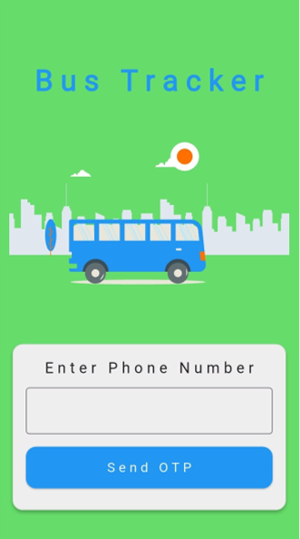
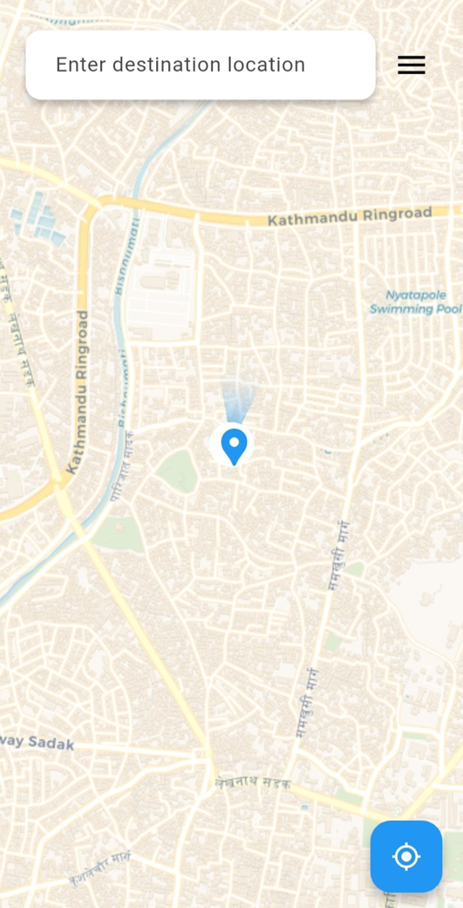
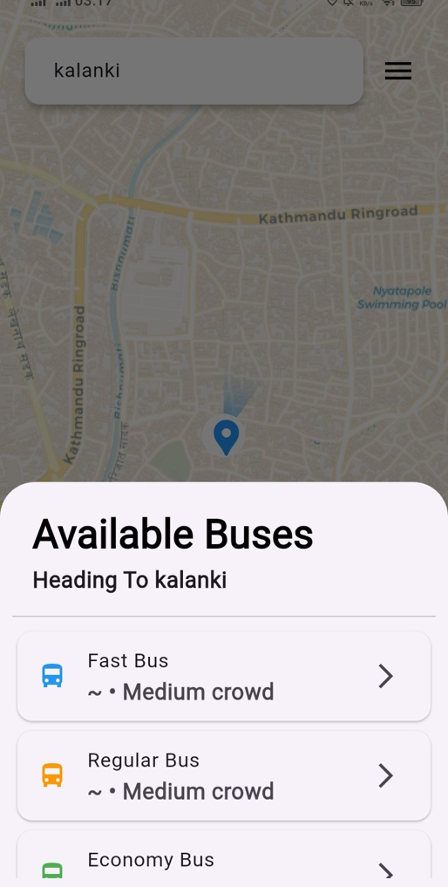
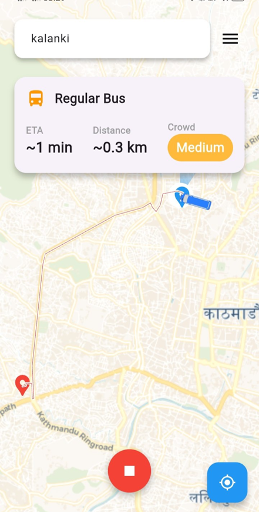

# Bus Tracker

A Flutter-based mobile application that simulates real-time bus tracking with live map visualization, route planning, ETA calculation, and crowd level prediction using the K-Nearest Neighbors (KNN) algorithm.

## Features

- 🔐 OTP-based phone authentication
- 🗺️ Live map with real-time location tracking
- 🚌 Simulated bus tracking with smooth animation
- ⏱️ Live ETA, distance & crowd level prediction
- 🧠 Crowd level prediction using KNN algorithm

## Tech Stack

- **Frontend:** Flutter
- **State Management:** Flutter Bloc / Cubit
- **Architecture:** Clean Architecture
- **Backend & Authentication:** Supabase
- **Maps:** flutter_map + OpenStreetMap / Carto tiles
- **Geocoding:** Nominatim
- **Routing:** OpenRouteService
- **Machine Learning:** K-Nearest Neighbors (KNN)

## Development Model

The project was developed using the **Incremental Development Model**, with functionality delivered through successive design, implementation, and testing cycles.

## App Screenshots

### Authentication

| Phone number sign-in | OTP verification |
| --- | --- |
|  |  |

### Find available buses

| Map and destination search | Available buses for the selected destination |
| --- | --- |
|  |  |

### Live bus tracking

  

